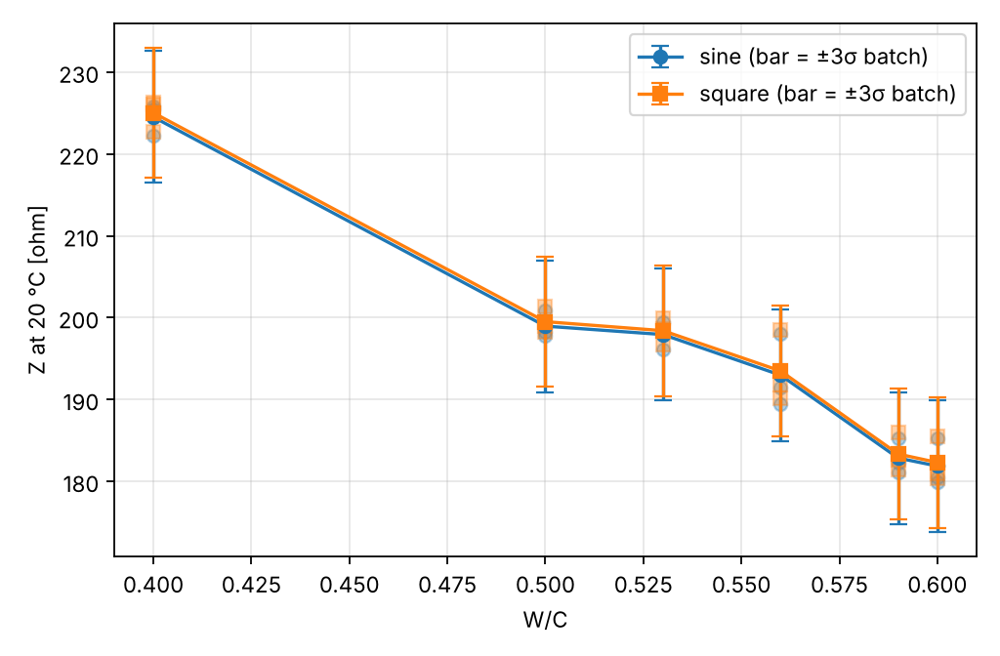

# 2조 W/C 판별 실험 분석 보고서

- 데이터: `/home/user/BLACKPINK/2조_전체/실험패키지/03_PC/test/data` (MEAS 94줄, REP 282줄, TEMP 83줄)
- **이 결과는 이 장치·이 시멘트·이 용기 조건에서의 값이다.** 현장 적용 성능을 뜻하지 않는다.

## 1. 온도계수 α

- 사용한 α: 사인파 0.0201/°C, 사각파 0.0199/°C (ALPHA 측정에서 추정)
- 보정식: Z20 = Z × [1 + α(T − 20)]  (전도도 기준 S20 = S ÷ [1 + α(T − 20)] 와 같은 뜻)

| 방식 | α 추정 [1/°C] | 점 수 | 온도 범위 [°C] | 맞춤 잔차 sd (비율) |
|---|---|---|---|---|
| 사인파 | 0.0201 | 6 | 15.0 | 0.0007 |
| 사각파 | 0.0199 | 6 | 15.0 | 0.0001 |

## 2. 보정 저항 확인

| 이름 | 방식 | 멀티미터 [Ω] | 측정 Z [Ω] | 오차 |
|---|---|---|---|---|
| CAL-100.4 | 사인파 | 100.4 | 100.57 | 0.17% |
| CAL-100.4 | 사각파 | 100.4 | 100.95 | 0.55% |
| CAL-996 | 사인파 | 996.0 | 994.14 | -0.19% |
| CAL-996 | 사각파 | 996.0 | 996.75 | 0.08% |

- 오차가 ±2%를 넘으면 `r1`·`rq` 명령으로 기준저항 실측값을 넣었는지, 집게가 제대로 물렸는지 확인.

## 3. 소금물 단조성 (농도↑ → Z↓ 이어야 정상)

| 방식 | 농도 [g/L] → Z20 [Ω] | 단조 감소 |
|---|---|---|
| 사인파 | 2→621.1, 4→330.0, 8→175.0 | 예 |
| 사각파 | 2→620.5, 4→330.6, 8→175.6 | 예 |

## 4. W/C 본 실험

### 4-1. 사인파

- 기기 반복성 (같은 측정 안 3회, CV 중앙값): **0.089%**
- 시료 반복성 (같은 배합, 재혼합 회차 간 sd): **0.78 Ω**
- 배합 재현성 σ_배합 (독립 배합 간 sd, 수준 합동): **2.69 Ω**
- 수화 경과에 따른 변화: 평균 0.133 %/분 (측정 창 안에서 이 값 × 경과분만큼 흔들림)

| W/C | 배합 수 | 배합 평균들 [Ω] | 평균 | sd |
|---|---|---|---|---|
| 0.40 | 3 | 225.9, 225.5, 222.2 | 224.52 | 1.99 |
| 0.50 | 3 | 197.8, 200.9, 198.2 | 198.97 | 1.69 |
| 0.53 | 3 | 198.3, 196.2, 199.4 | 197.94 | 1.65 |
| 0.56 | 3 | 191.4, 189.4, 198.1 | 192.99 | 4.51 |
| 0.59 | 3 | 181.1, 182.2, 185.3 | 182.85 | 2.17 |
| 0.60 | 3 | 180.5, 185.3, 179.9 | 181.88 | 2.95 |

기준 W/C 0.50 대비 (판정 규칙: |Δ| ≥ 3σ_배합이면 '구별됨')

| W/C | Δ [Ω] | Δ [%] | d = Δ/σ_배합 | 3σ 판정 |
|---|---|---|---|---|
| 0.40 | +25.55 | +12.84 | 9.51 | 구별됨 |
| 0.53 | -1.03 | -0.52 | -0.38 | 구별 안 됨 |
| 0.56 | -5.99 | -3.01 | -2.23 | 구별 안 됨 |
| 0.59 | -16.12 | -8.10 | -6.00 | 구별됨 |
| 0.60 | -17.10 | -8.59 | -6.36 | 구별됨 |

- 일원분산분석 (배합 평균, 수준 6개, 배합 18개): F(5, 12) = 100.24, p = 2.3e-09
- 단조성: 수준 평균이 한 방향으로 단조, Spearman ρ = -1.00
- 감도 (배합 평균의 직선 기울기): -208.25 Ω per W/C 1.0 → W/C 0.01당 -2.08 Ω
- **검출 가능한 최소 W/C 변화 (3σ_배합 / 감도): 0.039** — 판정선(+20 kg/m³ ≈ W/C +0.016) **보다 큼 → 판정선 수준은 구별 못 함**

### 4-2. 사각파

- 기기 반복성 (같은 측정 안 3회, CV 중앙값): **0.022%**
- 시료 반복성 (같은 배합, 재혼합 회차 간 sd): **0.74 Ω**
- 배합 재현성 σ_배합 (독립 배합 간 sd, 수준 합동): **2.65 Ω**
- 수화 경과에 따른 변화: 평균 0.126 %/분 (측정 창 안에서 이 값 × 경과분만큼 흔들림)

| W/C | 배합 수 | 배합 평균들 [Ω] | 평균 | sd |
|---|---|---|---|---|
| 0.40 | 3 | 226.3, 226.0, 222.7 | 225.04 | 2.00 |
| 0.50 | 3 | 198.2, 201.3, 199.0 | 199.52 | 1.62 |
| 0.53 | 3 | 198.6, 196.7, 200.0 | 198.42 | 1.66 |
| 0.56 | 3 | 191.9, 190.1, 198.5 | 193.50 | 4.43 |
| 0.59 | 3 | 181.5, 182.6, 185.9 | 183.34 | 2.31 |
| 0.60 | 3 | 181.0, 185.6, 180.4 | 182.31 | 2.82 |

기준 W/C 0.50 대비 (판정 규칙: |Δ| ≥ 3σ_배합이면 '구별됨')

| W/C | Δ [Ω] | Δ [%] | d = Δ/σ_배합 | 3σ 판정 |
|---|---|---|---|---|
| 0.40 | +25.52 | +12.79 | 9.61 | 구별됨 |
| 0.53 | -1.10 | -0.55 | -0.42 | 구별 안 됨 |
| 0.56 | -6.02 | -3.02 | -2.27 | 구별 안 됨 |
| 0.59 | -16.18 | -8.11 | -6.09 | 구별됨 |
| 0.60 | -17.20 | -8.62 | -6.48 | 구별됨 |

- 일원분산분석 (배합 평균, 수준 6개, 배합 18개): F(5, 12) = 102.94, p = 2e-09
- 단조성: 수준 평균이 한 방향으로 단조, Spearman ρ = -1.00
- 감도 (배합 평균의 직선 기울기): -208.56 Ω per W/C 1.0 → W/C 0.01당 -2.09 Ω
- **검출 가능한 최소 W/C 변화 (3σ_배합 / 감도): 0.038** — 판정선(+20 kg/m³ ≈ W/C +0.016) **보다 큼 → 판정선 수준은 구별 못 함**

## 5. 사인파 대 사각파 (같은 시료)

| 방식 | 감도 |기울기| / σ_배합 | 검출 최소 ΔW/C |
|---|---|---|
| 사인파 | 77.5 | 0.039 |
| 사각파 | 78.6 | 0.038 |

- 규칙('차이/σ'가 큰 쪽, 비슷하면 간단한 쪽)에 따른 선택: **사각파 (두 방식 차이가 20% 안 → 규칙대로 더 간단한 쪽)**

---
판정 기준: 차이 ≥ 3σ (σ = 독립 배합 간 표준편차). 펌웨어 LCD의 OK/ABN은 기준 시료 반복 σ나 `sig` 값으로 낸 **보조 표시**이고, 공식 판정은 이 보고서의 σ_배합 기준이다.
